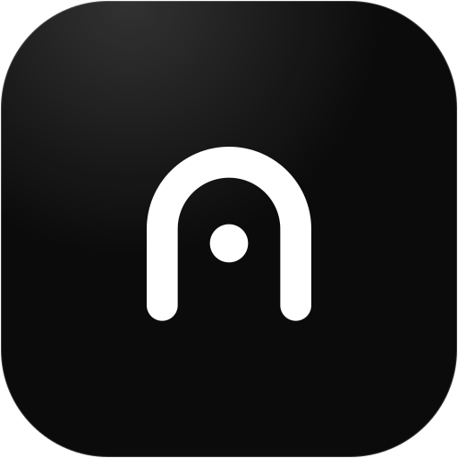

<p align="center">
  
</p>

<h1 align="center">Auralis</h1>

<p align="center">
  <a href="https://developer.android.com"></a>
  
  <a href="https://kotlinlang.org"></a>
  <a href="https://developer.android.com/compose"></a>
  <a href="LICENSE"></a>
  
</p>

Auralis is a native Android client for YouTube Music, built from scratch with Kotlin and Jetpack Compose. It pairs a native playback engine with a custom monochrome "Liquid Glass" interface.

> **Status: early development.** The project is at the start of Phase 1 (foundation). It cannot play music yet, and there is no Auralis release.

> **Disclaimer:** Auralis is an unofficial, independent project. It is not affiliated with, endorsed by, or sponsored by YouTube or Google. It does not modify or redistribute the official YouTube Music app.

## Planned features

The first release (MVP) will include:

- YouTube Music home feed, search, and browse/detail pages
- Audio streaming with background playback
- Media notification and lock-screen controls
- Queue management and playback state restore
- Library, liked music, and playlists (after the sign-in flow is verified)
- Works signed out; no Google Play Services required
- Liquid Glass design system with dark and light themes

These features are not built yet. See [Roadmap](#roadmap) for progress.

## Tech stack

| Layer | Technology |
| --- | --- |
| Language | Kotlin |
| UI | Jetpack Compose, Material 3 + custom Liquid Glass |
| Playback | AndroidX Media3 / ExoPlayer, MediaSessionService |
| Async | Kotlin Coroutines, Flow |
| DI | Hilt |
| Storage | Room, DataStore |
| Networking | Ktor Client, Kotlinx Serialization |
| YouTube Music | InnerTube via [InnerTubeX](https://github.com/MetrolistGroup/innertubex) (pending evaluation) |
| Build | Gradle Kotlin DSL with version catalog |

## Roadmap

- [ ] **Phase 1: Foundation.** Project setup, modules, DI, navigation, domain models.
- [ ] **Phase 2: Design system.** Theme, glass components, motion.
- [ ] **Phase 3: YouTube Music integration.** InnerTube client, home, search, detail pages.
- [ ] **Phase 4: Playback.** ExoPlayer, background service, queue, notification controls.
- [ ] **Phase 5: Product experience.** Now Playing, playlists, account library, settings.
- [ ] **Phase 6: Stabilization.** Tests, performance, and the first release APK.

## Building from source

Requirements:

- JDK 17 or newer
- Android SDK with platform 37 installed

```bash
git clone git@github.com:ignitrondev/Auralis.git
cd Auralis
./gradlew assembleDebug
```

The debug APK is written to `app/build/outputs/apk/debug/`.

## Privacy

- No analytics and no third-party trackers.
- The app only sends requests to YouTube Music and its media hosts.
- Auralis never asks for or stores your Google password. Session data stays in encrypted storage on your device.

## Previous project: IgniteTunes

This repository used to host IgniteTunes, a Flutter app. Auralis replaces it with a native rewrite. The old IgniteTunes builds (v1.0.0, v1.1.0) are still on the [Releases](https://github.com/ignitrondev/Auralis/releases) page, but they are no longer maintained.

## License

Auralis is licensed under the [GNU General Public License v3.0](LICENSE) (GPL-3.0). Third-party components and their licenses are listed in [NOTICE](NOTICE).

## Name and logo

The name **Auralis**, the name **IgnitronDev**, and the Auralis logo are brand assets of IgnitronDev. They are not covered by the source code license. Forks are welcome under the terms of the license, but they must not use the Auralis name or logo in a way that makes them look like the official app.

---

Copyright (c) 2026 IgnitronDev
